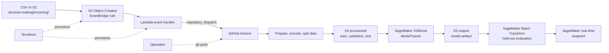

# Process Optimization with SageMaker

This is an end-to-end MLOps project that explores how to automate a human decision in a business process using machine learning. Built with Amazon SageMaker SDK v3, GitHub Actions and Terraform, the project automates key stages of the ML lifecycle, from data preparation and model training to evaluation and deployment. It combines reproducible workflows with event-driven retraining when new data arrives in Amazon S3, making predictions available to applications through a real-time SageMaker endpoint.

> The business use case and dataset are based on the process-optimization example from [*Machine Learning for Business*](https://www.manning.com/books/machine-learning-for-business).

## The business problem

The target is `tech_approval_required`, a binary label indicating whether an order should be routed to a technical approver. The model is intended to automate this step; predictions should be treated as decision support until model quality, operating thresholds and business impact have been validated with stakeholders.

The supplied CSV is [`data/orders_with_predicted_value.csv`](data/orders_with_predicted_value.csv).
It contains the target and order attributes such as requester, role, product, quantity, price and total.

## Architecture



The intended pipeline can also be started manually from GitHub Actions or by a matching push to `main`. For a dataset update, S3 emits an object-created event to EventBridge, which invokes Lambda. Lambda retrieves a GitHub token from AWS Secrets Manager and sends a `repository_dispatch` event; the matching workflow then starts.

## S3 data layout

The pipeline uses a configurable AWS S3 bucket and file object prefix. With the default prefix, the layout is:

```text
s3://<data-bucket>/decision-making/
├── incoming/
│   └── orders_with_predicted_value.csv   # source data
├── processed/
│   ├── train.csv                         # training channel
│   ├── val.csv                           # validation channel
│   └── test.csv                          # held-out labels and features
├── output/
│   └── <training-job>/                   # SageMaker model artifacts
├── test/
│   ├── test.csv                          # feature-only Batch Transform input
│   └── test.csv.out                      # temporary predictions
└── terraform/
    └── terraform.tfstate                 # remote Terraform state
```

`prepare_data` reads the configured source CSV, one-hot encodes categorical columns, selects columns whose absolute correlation with the target column is greater than `0.1`, then writes train, validation and test files to `processed/` folder.

The current split is a reproducible random split (`random_state=0`): 70% train, 20% validation and 10% test. The evaluation code submits the held-out features to SageMaker Batch Transform and calculates ROC AUC, accuracy, precision and recall from the returned scores.


## Model lifecycle

The SageMaker training module uses the v3 `ModelTrainer` API with `InputData`, `Compute`, `OutputDataConfig` and `StoppingCondition`. It configures the XGBoost `binary:logistic` objective, AUC evaluation metric, early stopping and managed Spot training. Training data and validation data are read from the `processed/` prefix; the trained model artifact is written to `output/`.

Evaluation of the trained model runs a Batch Transform job against the held-out test data and reports:

| Metric | What it indicates |
| --- | --- |
| ROC AUC | Measures how well the model ranks positive cases above negative cases across thresholds |
| Accuracy | Fraction of predictions that are correct, i.e., fraction of predictions that match the labels |
| Precision | Of orders predicted to require technical approval, the fraction that actually require it |
| Recall | Of orders that actually require technical approval, the fraction the model identifies |

The deployment module creates a SageMaker model, endpoint configuration and real-time endpoint. A SageMaker endpoint is invoked through AWS-authenticated API; it is not an unauthenticated public URL. The current deployment code deletes the prior endpoint before creating its replacement, so it does not provide zero-downtime or rollback behavior. Evaluation reports metrics but does not yet enforce a metric threshold as a deployment gate.

## Limitations and production improvements

This repository demonstrates an MLOps workflow, but several parts should be strengthened before using it to serve production traffic:

1. **Prevent evaluation leakage.** Feature selection currently runs on the complete dataset before it is split into training, validation and test subsets. As a result, information from the held-out data influences which features are selected, so the reported metrics are exploratory rather than an unbiased estimate of generalization. Split the data first, fit feature selection using only the training data and apply the fitted selection to validation and test data. Keep the test set untouched until final evaluation.
2. **Preserve service during deployments.** In order to minimize AWS costs, current deployment strategy deletes the existing endpoint before the replacement is ready, which leaves the service unavailable during deployment for a few minutes. In production, the old model must be kept serving while the new model is deployed and checked. Then traffic is shifted using a controlled strategy, such as a canary or blue/green rollout. The ability to route traffic back to the previous model must be retained if health checks or post-deployment metrics fail.
3. **Gate promotion on model quality.** Evaluation of trained model with test dataset report metrics, but those are not currently blocking deployment when they fall below an agreed standard. Business-aligned acceptance thresholds must be defined and make promotion conditional on passing them.

## GitHub Actions

The workflow is
[`train-and-deploy-sagemaker.yml`](.github/workflows/train-and-deploy-sagemaker.yml).
It declares these triggers:

| Trigger | Intended use |
| --- | --- |
| `workflow_dispatch` | Start a run manually from the Actions tab |
| Push to `main` | Run when a selected workflow or source/dependency file changes |
| `repository_dispatch` (`training_dataset_updated`) | Start after Lambda reports a new dataset |

The job uses Python 3.12 and `uv sync --locked`, then obtains short-lived AWS credentials through GitHub OIDC (`id-token: write`) and verifies the AWS identity before accessing resources. Long-lived AWS access keys are not required in GitHub when the OIDC trust relationship is configured correctly.

Configure the following GitHub Actions values:

| Name | Type | Purpose |
| --- | --- | --- |
| `AWS_REGION` | Variable | AWS region used by the job |
| `DATA_BUCKET` | Variable | Bucket containing the source CSV and artifacts |
| `S3_PREFIX` | Variable | Dataset prefix, for example `decision-making` |
| `DATASET` | Variable | Source CSV name, for example `orders_with_predicted_value.csv` |
| `AWS_ROLE_ARN` | Secret | IAM role assumed by the workflow through OIDC |
| `SAGEMAKER_EXECUTION_ROLE_ARN` | Secret | IAM role SageMaker uses to access data and artifacts |

`TRAINING_IMAGE` is also passed by the current workflow, although the training
module retrieves the XGBoost image URI itself.

The AWS role assumed by GitHub needs only the permissions required by the workflow, including access to the configured S3 prefix and permission to start, inspect and pass the SageMaker execution role for training, transform and endpoint operations. Restrict the OIDC trust policy to this repository and the intended branch or GitHub environment.

## Terraform-managed event trigger

The Terraform configuration in [`terraform/`](terraform/) provisions the dataset-notification path:

1. Enables S3-to-EventBridge event delivery for the existing bucket.
2. Creates a Lambda execution role and a Python 3.12 Lambda package.
3. Grants the Lambda access to CloudWatch Logs and the GitHub dispatch token in AWS Secrets Manager.
4. Creates an EventBridge rule for the configured S3 object event and routes matching events to the Lambda.
5. Grants EventBridge permission to invoke the Lambda.

The Lambda filters events by bucket, prefix and `.csv` suffix, reads the token from Secrets Manager and calls GitHub's repository-dispatch API. Store the token as a Secrets Manager JSON secret with a `token` field and grant the token permission to dispatch events to this repository.

When a matching dataset object is created or updated in S3, the Lambda function sends a GitHub repository_dispatch request to trigger the training_dataset_updated workflow event. The request includes a client_payload with the source bucket, dataset object key and S3 event identifier. The request is as represented in the following curl invocation:

```bash
curl --location 'https://api.github.com/repos/<repository-owner>/<repository-name>/dispatches' \
--header 'Accept: application/vnd.github+json' \
--header 'X-GitHub-Api-Version: 2022-11-28' \
--header 'Content-Type: application/json' \
--header 'Authorization: Bearer github_pat_2**********F' \
--data '{"event_type": "training_dataset_updated",
         "client_payload": {
            "bucket": "test-bucket",
            "dataset_key": "decision-making/incoming/orders_with_predicted_value.csv",
            "s3_event_id": "2A...4"
         }
        }'
```

GitHub Actions listens for this custom event alongside manual and push triggers. The Lambda retrieves its GitHub authentication token from AWS Secrets Manager; the token is never embedded in the workflow or repository.

Terraform stores state remotely at `s3://<bucket>/decision-making/terraform/terraform.tfstate`, with encryption and S3 lockfile-based state locking enabled. The backend bucket must already exist and the operator must have access to the state key and lock file.

From the repository root:

```bash
cd terraform
terraform init
terraform validate
terraform plan
terraform apply
```

Review the plan before applying it. The configuration manages S3 notifications on an existing bucket; coordinate with any other notification consumers to avoid replacing or disrupting their configuration. To remove the resources managed by this configuration, review the impact first and then run `terraform destroy`.

When running Terraform from Ubuntu on Windows 11/WSL, the author encountered DNS resolution problems. If you experience the same issue, see the [WSL DNS troubleshooting appendix](#appendix-wsl-dns-troubleshooting).

## Run locally with the notebook

The interactive local walkthrough is [`notebooks/tech_approval_required.ipynb`](notebooks/tech_approval_required.ipynb).
It covers the same core workflow as the Python modules: inspect and prepare the data, train the XGBoost model with SageMaker, evaluate it and create and interact with a SageMaker endpoint. Open the notebook in VS Code with the Jupyter extension or another Jupyter environment, configure its Python kernel and run the cells in order.

Before running it, configure AWS credentials for an account with access to the S3 data bucket and permission to use SageMaker. Set the notebook's expected values in a local `.env` file, using [`.env-example`](.env-example) as a starting point. Keep credentials and other secrets out of the notebook and repository. The Python modules under `src/process_optimization/` provide the corresponding non-interactive stages used by the GitHub Actions pipeline; they are not the recommended local entrypoint.

Training, Batch Transform and endpoint hosting incur in AWS charges. Delete notebook-created SageMaker resources when finished; in particular, a deployed real-time endpoint continues to incur cost until it is deleted. At the end of the notebook there is a cell specifically for deleting any Sagemaker resources that may incur in costs.

## Appendix: WSL DNS troubleshooting

Directly connected to internet, with no VPN, no HTTP proxy and no custom DNS, the author experienced DNS resolution problems running Terraform from Ubuntu on Windows 11/WSL. The following  workaround was used in that environment; it changes WSL's resolver configuration and should only be applied when appropriate for your  network.

For background and current WSL guidance, see Microsoft's documentation:

- [Troubleshooting Windows Subsystem for Linux](https://learn.microsoft.com/en-us/windows/wsl/troubleshooting)
- [Advanced settings configuration in WSL](https://learn.microsoft.com/pt-pt/windows/wsl/wsl-config)
- [Networking in WSL](https://learn.microsoft.com/en-us/windows/wsl/networking)

1. Add the following network setting to `/etc/wsl.conf`. If the file already has a `[network]` section, add or update the setting there rather than creating a duplicate section.

   ```ini
   [network]
   generateResolvConf=false
   ```

2. Back up the current resolver configuration, then replace it with explicit DNS servers:

   ```bash
   sudo cp -L /etc/resolv.conf /etc/resolv.conf.backup
   sudo rm /etc/resolv.conf
   sudo tee /etc/resolv.conf >/dev/null <<'EOF'
   nameserver 1.1.1.1
   nameserver 1.0.0.1
   EOF
   ```

3. From Windows PowerShell or Command Prompt, shut down WSL so the configuration change takes effect:

   ```powershell
   wsl --shutdown
   ```

4. In the WSL shell, prefix each Terraform command with `GODEBUG=netdns=cgo` to use Go's C-based system DNS resolver. 

   For example:

   ```bash
   cd terraform
   GODEBUG=netdns=cgo terraform init
   GODEBUG=netdns=cgo terraform plan
   GODEBUG=netdns=cgo terraform apply
   ```

   Continue using the prefix for other Terraform commands, including `validate` or `destroy`, if the DNS problem affects those commands too.
